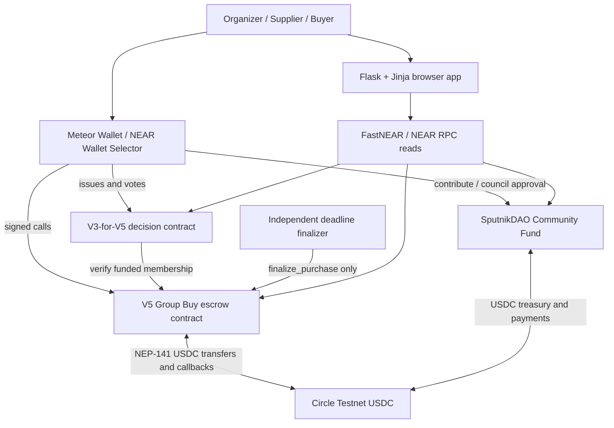

# HarvestPool

**Buy together. Govern together. Keep pooled money accountable.**

**Live NEAR Testnet demo:** https://harvestpool.penipex.com<br>
**Source:** https://github.com/dalamaa/HarvestPool<br>
**Hackathon tracks:** Social Money · Real-World Money<br>
**Status:** Working Testnet prototype. No real goods were delivered during the demo. Not audited or ready for real funds.

## The problem

Buying food and everyday supplies alone costs more. Families, neighbors, and local communities could save money through shared orders from farmers, but informal group purchases bring other costs: **Who holds the money? What if they misuse it or disappear? Who decides what happens when people disagree?** Some members avoid confrontation altogether, so their concerns never reach the group.

The same problem appears when communities collect contributions for a garden, school supplies, medical support, or another shared cause. People may want to help, but they also want to know where the money goes and who can authorize a payment.

## The solution

**HarvestPool makes it easier, safer, and more enjoyable to pool resources.** It has two connected experiences:

**1. Group Buys.** An organizer proposes an order, and the named supplier must accept the terms before contributions open. Buyers review a fixed agreement and pay into a NEAR contract instead of an organizer's wallet. Paid members can raise concerns, vote on eligible decisions, and review fulfillment evidence. The supplier can receive payment only after the required contract conditions and member approvals. If a deal fails, eligible buyers can claim refunds directly under the contract rules.

**2. Community Funds.** People can contribute to a shared cause, see verified balances and activity, and rely on an authorized community council for expenditure decisions. The implemented SputnikDAO configuration has **three authorized decision-makers** and requires **two approvals** before a fund payment can proceed. Donors do **not** automatically gain a vote simply because they contributed.

**NEAR is the difference between an agreement and a promise.** Wallet signatures establish who takes each action. Smart contracts apply the Group Buy terms, enforce paid-member eligibility, track contributions, and control payouts and refunds. SputnikDAO applies the Community Fund's separate approval policy. The web server displays the results; it does not custody the Group Buy payments or sign on users' behalf.

> **Trust has limits.** HarvestPool cannot prove a real-world delivery, verify supplier identity, or make public blockchain transactions anonymous. These are explicitly disclosed below.

## Try the live app in two minutes

You can explore public Testnet records without a wallet or any tokens.

| Do this | See this |
| --- | --- |
| Open [Explore Deals](https://harvestpool.penipex.com/deals) | Available purchases, supplier, terms, quantity, deadlines and contract status |
| Open a deal and its Deal Terms | Fixed order terms and the contribution path; merely opening a deal does not make you a member |
| Open [Community Funds](https://harvestpool.penipex.com/community-funds) | Configured funds, goals, verified treasury information and contribution activity |
| Open Community Garden | A $100 Testnet USDC goal, recorded donations and the fund's separate DAO authority |
| Check the linked [completed payout](https://testnet.nearblocks.io/txns/Gp32zhkmfXFqnL1c6zPPsoy55Fh1LVjjvk3EYiNqLHCm) | A finalized Circle Testnet USDC transfer and successful V5 settlement callback |
| Check the linked [buyer refund](https://testnet.nearblocks.io/txns/G63ozfWnVsZRRUpZ4zrucMVYR7VErFTEF4NtfurCJy4N) | A finalized USDC refund to the original funded buyer |

### Walkthrough A: A complete Group Buy

1. Open **Post a Group Deal**. An organizer selects the supplier, quantity, price, contribution cutoff, fulfillment deadline and pickup terms. The contract records the proposal as **AwaitingSupplier**.
2. The *named supplier* opens the invitation with their own Testnet wallet, reviews the terms and **accepts**. The contract changes the deal to **Open**. An arbitrary account cannot accept on that supplier's behalf.
3. A buyer opens the deal, reviews its agreement, chooses a quantity and connects **Meteor Wallet** on NEAR **Testnet**. A successful exact USDC transfer makes the wallet a **funded member**. Page visits or an interest click do not count.
4. Once the contribution deadline passes, any caller can run **finalize_purchase**. The authoritative contract state becomes **Funded** if the minimum was met or **Failed** otherwise. The repository also contains an independent restricted finalizer, but the shared worker is currently disabled and is not a guaranteed hosted service.
5. A funded member can raise a supported issue. The separate decision contract verifies membership and allows **one vote per funded wallet**, not one vote per box. A recorded vote does not automatically mean the proposal passed.
6. The supplier submits fulfillment evidence. Funded buyers review and approve it before the contract's **fulfillment deadline**. Once the required threshold is met, an eligible actor initiates supplier payout. The result is complete only after the token transfer and contract callback confirm it.
7. If a purchase fails, each eligible buyer can select **Claim Refund**. The contract verifies eligibility and performs a separate token transfer. Refunds are **not automatic**, and a pending refund is not a completed refund.

**For judges:** The app uses simulated fulfillment references for Testnet exercises. The completed Fresh tomatoes payout and the failed Apples refund are distinct deals. Do not interpret the approval as proof that physical tomatoes arrived.

### Walkthrough B: A Community Fund

1. Open **Community Funds**, then a configured fund such as **Community Garden**.
2. Review the purpose, goal, currency, DAO account and contribution rules. Connect a Testnet wallet if you choose to donate.
3. Approve a contribution of **Circle Testnet USDC**. After final receipt verification, the fund shows the updated recorded amount. The hosted Garden currently exposes multiple verified Testnet contribution receipts; these are not purchases of Group Buy shares, and the count can change as the demo is exercised.
4. A council member can submit a permitted payment request to the configured **SputnikDAO**. **The first approval does not release the money**; the configured policy needs a second authorized approval. DAO proposal and payout evidence must be verified separately from donation evidence.
5. A donor without council authorization can contribute, but that alone does not give the donor a governance vote.

**Current scope:** The prototype supports specific configured DAO treasuries, including Community Garden and the example Shared Community Equipment fund. A new fund request in the interface is not an instant on-chain DAO deployment, and the product does not yet provision unlimited independent fundraising campaigns automatically. The Community Garden $100 contribution cap is enforced in the web flow, **not by a DAO-enforced cap**. Community Fund contributions cannot be personally withdrawn or automatically refunded like failed Group Buy contributions.

## What NEAR makes possible

| Technology | Responsibility | Why it matters |
| --- | --- | --- |
| **NEAR Rust smart contracts (V5)** | Supplier approval, immutable purchase terms, exact USDC commitments, capacity, fulfillment conditions, refund and payout states | The organizer cannot simply take everyone's pooled purchase money |
| **V3-for-V5 decision contract** | Funded-member eligibility, issues, one-wallet-one-vote decisions, vote thresholds and supplier consent for supported changes | Participants can have a say without an organizer deciding alone |
| **SputnikDAO** | Separate Community Fund treasuries and council-governed expenditure proposals | One council member cannot authorize a payment that needs two approvals |
| **Circle native USDC on NEAR Testnet** | Six-decimal NEP-141 token used for purchases and configured community contributions | The prototype uses dollar-denominated Testnet amounts instead of floating native-NEAR price estimates |
| **NEAR Wallet Selector 10.1.4 + Meteor Wallet** | User-held wallet authorization for contract calls | The app does not request private keys or sign as the user |
| **FastNEAR JSON-RPC + NearBlocks** | Public contract reads, transaction receipts and explorer links | Judges can inspect outcomes independently of UI notifications |
| **Flask 3.1.2, Python, Jinja2 and vanilla JavaScript** | Web routes, presentation, cached verified metadata and browser workflows | A simple interface puts food, fund goals and decisions first |
| **SQLite** | Non-custodial metadata, verified activity records and worker state | Supports repeatable reads and worker recovery; does not replace NEAR financial authority |
| **Independent finalizer (Python/systemd)** | Can attempt eligible `finalize_purchase` calls after the join deadline | A separately provisioned operator can advance expired deals; the shared worker is currently disabled, and it does **not** approve fulfillment, release supplier payment or claim refunds |
| **Rust `near-sdk` / Borsh / `near-workspaces`** | Contract state and tests with isolated NEAR Sandbox | Financial behavior can be tested before use against public Testnet contracts |

### Financial architecture



**Two separate money paths:** A Group Buy uses the V5 escrow rules. A Community Fund uses its own DAO treasury and DAO policy. A community donation does not become a refundable purchase commitment, and a donor does not become a purchase voter.

## Independent, on-chain evidence

These are **actual Testnet transactions**, not mocked UI balances. The corresponding contract state and additional proof are in [`docs/v5-financial-baseline.md`](docs/v5-financial-baseline.md) and [`docs/release-fitness-report.md`](docs/release-fitness-report.md).

| Outcome | Evidence |
| --- | --- |
| **Supplier payout:** V5 Deal #0, Fresh tomatoes, 4 USDC | [NEAR Testnet transaction](https://testnet.nearblocks.io/txns/Gp32zhkmfXFqnL1c6zPPsoy55Fh1LVjjvk3EYiNqLHCm); completed token transfer and callback |
| **Buyer refund:** V5 Deal #1, 2 USDC | [NEAR Testnet transaction](https://testnet.nearblocks.io/txns/G63ozfWnVsZRRUpZ4zrucMVYR7VErFTEF4NtfurCJy4N); returned tokens to the original buyer |
| **Community equipment contribution:** 1 USDC | [Recorded Testnet contribution](https://testnet.nearblocks.io/txns/JD8WYyoGFAxxNdApXDNrRfKpia59RAN41SWGDwZSGbE6); source evidence manifest in [`.env.example`](.env.example) |
| **Community equipment DAO votes and payment:** 0.80 USDC | [First approval](https://testnet.nearblocks.io/txns/pyRs5SKSNPW4A33E9nxsxMjv9YNB6vWMZFeS8oEGr7Y) moved no USDC; the [second, deciding approval](https://testnet.nearblocks.io/txns/DNBNDTgi6bEHsjnWX92WaS9v8U1nyhYiqxfKYKsnfA2p) executed DAO proposal #2 and produced the exact token receipt recorded in the evidence manifest |

Testnet donations and token transfers have **no claimed commercial value**, and all fulfillment evidence in the demo is explicitly simulated. The public chain permits reviewers to validate receipts, signers, methods and token transfer amounts independently.

### Current deployed contract identifiers

```text
Network:               NEAR Testnet
V5 Group Buy escrow:   harvestpool-v5-usdc-dalamaa-20261109.testnet
V3-for-V5 governance:  harvestpool-v3-v5-dalamaa-20261109.testnet
Circle Testnet USDC:   3e2210e1184b45b64c8a434c0a7e7b23cc04ea7eb7a6c3c32520d03d4afcb8af
Community equipment:   harvestpool-community.sputnikv2.testnet
Community Garden DAO:  harvestpool-community-garden.sputnikv2.testnet
```

V4 native-Testnet-NEAR code and earlier V2/V3 experiments remain in the repository for historical comparison. **V5 + V3-for-V5 + Circle Testnet USDC** is the canonical current Group Buy demo. There is no silent fallback to V4.

## Reproduce locally from a fresh clone

### Requirements

- Git and internet access.
- **Python 3.10+**; Python 3.11 or 3.13 is a suitable tested reference from the repository documentation.
- **macOS, Linux, or Windows** with a current desktop browser. Development and manual multi-wallet demos used **macOS**, Google Chrome, Chrome Canary and Brave with **separate browser profiles**.
- **Node.js 20+** only for browser tests or intentional wallet-bundle rebuilds.
- **Rust/Cargo** only for contract tests; no Docker, NEAR CLI or local finalizer is needed for a read-only site review.
- For a signed demo, install the [Meteor Wallet](https://meteorwallet.app/) browser extension, create/use a **NEAR Testnet** account, and obtain Testnet NEAR for gas. A USDC contribution additionally requires the correct **Circle Testnet USDC** token and any NEP-145 storage deposit requested by the app. Never use a Mainnet wallet or real funds.

### macOS / Linux

```bash
git clone https://github.com/dalamaa/HarvestPool.git
cd HarvestPool
python3 -m venv .venv
.venv/bin/python -m pip install -r web/requirements.txt
.venv/bin/python run.py
```

Open **http://127.0.0.1:5011**. Select **Explore Deals** or **Community Funds**. The launcher uses public, pinned V5/V3/USDC defaults; **no `.env` file, private key, npm installation or wallet connection is required for public views**. If port 5011 is busy, use:

```bash
.venv/bin/python run.py --port 5511
```

For an explicit environment file, copy the checked-in public example:

```bash
cp .env.example .env
```

It pins the same V5 escrow, V3-for-V5 governance contract, Circle Testnet USDC token and example Community Fund evidence. `.env` is ignored by Git. Do not add wallet credentials, private keys, seed phrases, FastNEAR keys or NearBlocks keys; the web app does not need them. On macOS/Linux, the managed `./start.sh`, `./status.sh` and `./stop.sh` workflow is also available after activating the virtual environment. The portable `run.py` command is the cross-platform judge path and never starts the finalizer.

### Windows PowerShell

```powershell
git clone https://github.com/dalamaa/HarvestPool.git
cd HarvestPool
py -3 -m venv .venv
.\.venv\Scripts\python.exe -m pip install -r web\requirements.txt
.\.venv\Scripts\python.exe run.py
```

Open **http://127.0.0.1:5011**. Use `Ctrl+C` to stop. Windows users do not need Git Bash or WSL for the Python launcher.

### Browser and wallet setup for a complete judge trial

1. Open the app in **Chrome or Brave**. Keep public viewing separate from wallet authorization.
2. Install Meteor Wallet, select **Testnet**, and connect through the app. Approve only wallet actions whose contract, method, token and amount you recognize.
3. For a multi-role trial, use **separate browser profiles**, each with its own Testnet account: organizer, named supplier, buyer A, and optionally buyer B. Chrome Canary can act as an additional isolated browser; it is not required.
4. Start with existing public deals and transaction receipts; they work even if a test wallet has no USDC. For new deals, choose adequate contribution and fulfillment deadlines. Supplier acceptance must happen before the contribution deadline, and buyer evidence votes must complete before the fulfillment deadline.
5. **Do not replay a transaction merely because the browser shows a slow or missing confirmation.** Check contract status or its receipt before another attempt.

### Run the automated checks

In the cloned repository, with the Python environment installed and Node.js 20+ available:

```bash
.venv/bin/python -m unittest -v \
  web.test_portable_startup \
  web.test_community_fund \
  web.test_community_requests \
  automation.test_finalizer \
  automation.test_healthcheck \
  automation.test_rpc_config
.venv/bin/python -m py_compile web/app.py
node --test web/static/*.test.js
node --check web/static/app.js
```

On Windows use `.\.venv\Scripts\python.exe` for Python tests. No `npm install` is required for the checked-in browser tests.

If Rust is installed, validate both canonical contracts:

```bash
cargo test -p harvest-pool-v5-contract
cargo test -p harvest-pool-v3-v5-contract
```

The four V5 end-to-end NEAR Sandbox tests are **ignored by default** because they require compiled WASM and a Sandbox runtime. To run them, install the documented `cargo-near` version and build the V5, decision and mock-USDC WASM artifacts before enabling the ignored integration suite. See [`docs/v5-usdc.md`](docs/v5-usdc.md) and the [existing contract test instructions](docs/infrastructure-reliability-audit.md). Do not represent ignored journeys as executed.

**Clean-clone verification is separate from deployed operation.** A public clone can reproduce the UI and deterministic tests, but its SQLite state, wallet profiles and network conditions differ from the hosted application. The public NEAR contracts and receipts are shared authoritative state.

### Troubleshooting

- **Wrong account / missing supplier controls:** Confirm the Testnet wallet matches the supplier account named in the deal. A connected wallet is not itself authorization; account-specific contract state must verify successfully.
- **RPC / HTTP 429:** FastNEAR and public providers can rate-limit requests. The browser uses bounded, deduplicated reads and targeted refresh. Avoid many open polling tabs; a failed read is not proof of a failed transaction.
- **Nothing happens after a deadline:** Read the authoritative deal state. Any caller may invoke the contract's permissionless finalization method, or a separately provisioned finalizer can do so. The shared worker is currently disabled. Finalization does not auto-pay suppliers or auto-refund buyers.
- **Missing Community Fund vote:** Contributors are not automatically council members. The configured DAO policy controls eligible voters and the approval threshold.
- **Build / Python failures:** Use Python 3.10+, check network access to PyPI, and avoid `sudo pip`. Wallet Selector is bundled; regenerate it only if you intentionally update dependencies with `npm ci && npm run build:wallet`.

## Design boundaries and honest limitations

1. **Testnet and simulation.** This is a hackathon prototype, not a licensed marketplace, audited payment product or proof of actual food delivery. It has no card checkout or supplier bank payouts.
2. **No custody by the organizer or web server.** The smart contract controls Group Buy tokens under its code, but deployed contract administrators may retain upgrade authority. A full production release needs independent audits and governed upgrades.
3. **Community Funds are distinct.** DAO treasuries follow their own policy, not V5 refund rules. Council approvals do not give every donor a vote. New fund requests do not automatically create independent DAO accounts, and the Garden cap is UI-enforced.
4. **Public ledger, not anonymity.** People can contribute without publicly announcing a personal identity to neighbors, but NEAR wallet addresses, amounts, transfers and votes are visible. Avoid claims of private or anonymous on-chain finance.
5. **Real-world supplier trust.** Supplier wallet authorization does not prove legal identity, food safety, delivery or quality. A buyer's approval reviews submitted evidence, not independent physical proof.
6. **Deadline sensitivity.** The contract has a contribution cutoff and a separate fulfillment/approval cutoff. A late approval can be rejected. Failed deals can require an explicit expiration action, followed by individual refund claims.
7. **Callbacks and availability.** Pending USDC transfers may need reconciliation if callback evidence is missing. Public RPC, indexing, wallet popups and providers may lag, time out or rate-limit. Never convert a pending UI state into an invented success.
8. **Single wallet does not equal one human.** Voting is one eligible funded account per vote, not a verified human identity system.

## Repository map and deeper technical evidence

| Path | Purpose |
| --- | --- |
| `web/`, `run.py` | Python Flask app, Jinja views, browser wallet integration, public APIs and JavaScript tests |
| `contract-v5/` | Current Circle Testnet USDC Group Buy escrow contract and tests |
| `contract-v3-v5/` | Current funded-member governance contract and tests |
| `mock-usdc/` | Local standard six-decimal token test fixture; not Circle's deployed token |
| `automation/`, `ops/systemd/` | Restricted deadline finalizer and service setup |
| `contract/`, `contract-v3/`, `contract-v4/` | Preserved earlier versions and native-NEAR compatibility tests |
| [`docs/v5-financial-baseline.md`](docs/v5-financial-baseline.md) | Verified Testnet payout, refund, token arithmetic and contract hashes |
| [`docs/v5-usdc.md`](docs/v5-usdc.md) | Exact USDC architecture, deployment, safety checks and Sandbox preparation |
| [`docs/automatic-finalization.md`](docs/automatic-finalization.md) | Finalizer security, polling, health and recovery instructions |
| [`docs/engineering-decisions.md`](docs/engineering-decisions.md) | Why the system uses separate escrow and governance contracts |
| [`docs/infrastructure-reliability-audit.md`](docs/infrastructure-reliability-audit.md) | Historical test evidence, known failure modes and release gates |

## Hackathon submission and development window

HarvestPool was built for **NEAR HACKATHON** as a NEAR Testnet prototype. The current submission emphasizes **Social Money** (governed pooled contributions via SputnikDAO) and **Real-World Money** (USDC escrow for supplier orders). This repository's public history begins on **November 8, 2026**, inside the hackathon development window; there is no pre-window code baseline in this repository. Judges can review the complete [commit history](https://github.com/dalamaa/HarvestPool/commits/main/) and the preserved legacy iterations alongside canonical V5.

**No mainnet transactions were required to demonstrate this product.** The hosted public demo should remain available throughout the judging period. Source files and test fixtures are open under **Apache-2.0**; see [`LICENSE`](LICENSE).

**Software and tooling:** Rust/near-sdk, NEAR Wallet Selector/Meteor Wallet, near-api-js, Python/Flask/Jinja2, SQLite, NEAR Sandbox/near-workspaces, `npm`/esbuild, the standard SputnikDAO contracts and Circle's Testnet USDC token. Existing libraries and historical components are credited by their dependencies and repository history. Code-assistant tools helped with implementation and review; all claimed transactions and verification results should come from executable code, receipts or test runs.
