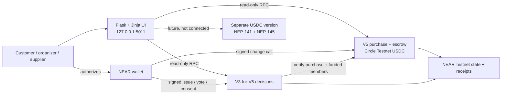

# HarvestPool

> **Buy together. Save more. Without the trust issues.**

HarvestPool makes group purchases easier, safer, and fairer. Communities can combine their
purchasing power to get better bulk prices, make important decisions through fair votes without
uncomfortable confrontations, and protect their pooled funds from unilateral withdrawals. Clear
rules for commitments, payments, and refunds give both buyers and farmers greater confidence.

This is a working NEAR Testnet hackathon prototype, not an audited production marketplace. The
canonical local application is V5 on **Circle Testnet USDC**, with its dedicated V3-for-V5 governance
contract. Both are deployed on Testnet and have completed a low-value financial journey. V4 uses
native Testnet NEAR and remains available only as a legacy application. See the [verified V5
financial baseline](docs/v5-financial-baseline.md).

The release boundaries are intentional:

- **V5** is the canonical local application and is deployed and verified with Circle Testnet USDC
  for a successful supplier payout and a failed-purchase refund; local Sandbox coverage remains
  part of the regression suite.
- **V4** is a legacy application on NEAR Testnet with native Testnet NEAR.
- **V3-for-V5** is deployed and verified with funded-member voting and supplier consent against V5.
- **Circle USDC Testnet payments** are verified for the documented low-value Testnet journey only;
  this is not production-payment or delivery evidence.
- Card payments and US bank payouts are not implemented.

## What problem it solves

An informal group buy often makes the organizer the bank, bookkeeper, and final decision-maker.
Members must trust that person not to redirect pooled money. A supplier can also be named without
accepting the proposed terms, and the people who actually contributed may have no fair way to
resolve later coordination questions.

HarvestPool assigns those responsibilities to explicit NEAR contract rules:

- a supplier signs before an organizer's proposed deal can open;
- a contribution counts only when the exact native-NEAR amount reaches the purchase contract;
- one active paid commitment creates one funded membership, regardless of quantity;
- only eligible funded members approve fulfillment and participate in supported group decisions;
- the organizer has no withdrawal, arbitrary payout, or generic sweep method;
- supplier payment and member refunds follow explicit pending/callback states.

The Flask application presents the marketplace. It does not sign for users, hold pooled funds,
decide eligibility, or release payment.

### V5 native-USDC application

- Exact six-decimal NEP-141 contributions through the configured token's `ft_transfer_call` and
  V5 `ft_on_transfer`; wrong token/message/amount returns the full unused amount.
- Pending operation IDs, recipient storage checks, one-yocto `ft_transfer`, private callbacks,
  observed-failure retry, and frozen reconciliation state for ambiguous missing callbacks.
- Contract balance/liability reconciliation and a dedicated V3-for-V5 with bounded, cleanable
  pending membership validations.
- Local Sandbox coverage with a standards-based mock USDC token. This is not evidence that Circle
  Testnet transactions already work.

See [V5 native-USDC architecture and readiness](docs/v5-usdc.md) for the identity check, state
machine, artifacts, and isolated-account runbook. The current verified state is recorded in the
[V5 financial baseline](docs/v5-financial-baseline.md).

## Why NEAR

NEAR is the enforceable trust boundary rather than an add-on payment badge. Wallet signatures
identify the caller; attached deposits make contributions atomic with contract accounting; public
state exposes the agreement and progress; cross-contract reads let the decision contract verify
funded membership; and promises/callbacks let financial transfers distinguish pending, observed
success, and observed failure.

These capabilities do not prove delivery, legal identity, dollar value, or perfect callback
recovery. Those limits are stated below and in
[Engineering decisions](docs/engineering-decisions.md).

## Implemented features

### V4 purchase and escrow contract

- Allowlisted supplier offers, or organizer requests that remain `AwaitingSupplier` until the named
  supplier accepts.
- SHA-256 agreement fingerprint bound to the purchase and immutable financial/fulfillment terms.
- Exact native-Testnet-NEAR commitments with one commitment per account, unit limits, and a maximum
  funded-household limit.
- Contract-execution capacity checks; concurrent final-slot attempts accept at most one.
- Voluntary cancellation before the cutoff and pull refunds after cancellation or purchase failure.
- Named-supplier fulfillment evidence and one vote per active funded member.
- Supplier payout only after the required `ceil(2n/3)` fulfillment approval.
- Pending states before outgoing transfers, private callbacks, duplicate-transfer guards, and retry
  after an observed transfer failure.

### Dedicated V3-for-V4 decision contract

- Issues and Yes/No or multiple-choice group decisions.
- Cross-contract membership validation against the configured V4 contract.
- Frozen active-funded-member voter snapshots, one public choice per account, and a
  `ceil(2n/3)` matching-choice threshold.
- Rejected, expired, and `NoConsensus` outcomes; named-supplier consent for supported pickup
  arrangements after the ballot passes.
- No authority to change V4 price, quantity, supplier, commitments, refunds, payout, or lifecycle.

### Customer application

- Public Home and Explore pages; deal details, share links, Deal Terms, and contribution flow.
- Organizer/supplier creation modes and named-supplier invitation review.
- Wallet-scoped **My Group Buys**, **My Decisions**, issue creation, fulfillment review, refunds,
  and supplier dashboard.
- NEAR Wallet Selector 10.1.4 with Meteor Wallet for signed Testnet calls; read-only FastNear RPC
  for browser-compatible public reads.
- Wallet-scoped pending actions and authoritative state rereads before displaying completion.

## Architecture



| Layer | Authority |
| --- | --- |
| Flask/Jinja and SQLite | Presentation, public configuration, nonfinancial metadata; no signing or custody |
| NEAR wallet | User-controlled account authorization |
| V4 contract | Supplier agreement, contributions, membership, lifecycle, refund and payout rules |
| V3-for-V4 contract | Issues, voter snapshots, thresholds and decision outcomes; no financial authority |
| V5 contract | Isolated Circle Testnet USDC purchase, accounting, refund and supplier payout rules |
| V3-for-V5 contract | Issues, voter snapshots, thresholds and supplier consent for V5; no financial authority |
| NEAR Testnet | Public contract state and transaction/receipt evidence |

The contracts use Rust, `near-sdk` 5.30.1, Borsh, promises and callbacks. Integration tests use
`near-workspaces` 0.24.0-rc.2 with local NEAR Sandbox. The browser uses public JSON-RPC and NEAR
Wallet Selector. The canonical V5 app uses NEP-141/NEP-145. V4 uses native NEAR and is kept
separate as a legacy configuration.

## Current Testnet contracts

| Role | Account | Verified configuration |
| --- | --- | --- |
| V4 purchase/escrow | [`harvestpool-v4-dalamaa-20261109.testnet`](https://explorer.testnet.near.org/accounts/harvestpool-v4-dalamaa-20261109.testnet) | `V4`, `supplier-authorized-no-offer-vote`, `native-testnet-near` |
| V3 decisions for V4 | [`harvestpool-v3-v4-dalamaa-20261109.testnet`](https://explorer.testnet.near.org/accounts/harvestpool-v3-v4-dalamaa-20261109.testnet) | Configured only for the V4 account; public Yes/No and multiple-choice voting |
| V5 USDC purchase/escrow | [`harvestpool-v5-usdc-dalamaa-20261109.testnet`](https://explorer.testnet.near.org/accounts/harvestpool-v5-usdc-dalamaa-20261109.testnet) | Isolated V5; Circle Testnet USDC; live payout/refund baseline verified |
| V3 decisions for V5 | [`harvestpool-v3-v5-dalamaa-20261109.testnet`](https://explorer.testnet.near.org/accounts/harvestpool-v3-v5-dalamaa-20261109.testnet) | Reads V5 funded membership; live two-buyer decision baseline verified |

Read-only verification on 2026-11-09 found one open V4 purchase with one active native-NEAR
commitment, and zero V3 issues/decisions at that observation time. Live state may change. Account
creation, deployment, initialization transactions, source/artifact hashes, and reproducibility
limits are in [V4 deployment evidence](docs/v4-deployment.md). Earlier Phase 1 and V2 evidence is
kept separately in [Testnet evidence](docs/testnet-evidence.md) and must not be presented as V4
journey proof.

## Requirements

- Git.
- Python 3.10+ and `venv` (verified locally with Python 3.11.9).
- Rust and Cargo (verified with Rust/Cargo 1.99.1; release metadata targets Rust 1.85.1).
- Node.js 20+ for the dependency-free frontend tests (verified with Node 20.15.0).
- Internet access for live Testnet RPC, wallet/CDN modules, and the optional NEAR/USD display.
- A browser with Meteor Wallet and a faucet-funded `.testnet` account only for signed demo actions.
- Optional: `cargo-near` 0.23.0 for deployable WASM builds (the version currently verified in the
  audit workspace). It is not needed for ordinary unit tests. The contract metadata still names an
  older 0.22.0 reproducible-build image and must be refreshed and verified on native x86_64 Linux
  before claiming reproducibility.

No npm install is required. The browser loads the pinned wallet modules from `esm.sh`.

## Fresh installation

The public repository is the source of truth for the submission revision. A clean clone should be
able to reproduce the documented local checks below; live Testnet state and wallet transactions are
separate evidence and are not created by installation.

Once the submission revision is public:

```sh
git clone https://github.com/dalamaa/HarvestPool.git
cd HarvestPool
python3 -m venv .venv
. .venv/bin/activate
python -m pip install -r web/requirements.txt
cp .env.example .env
```

The example environment contains public identifiers only:

```dotenv
PORT=5011
NEAR_NETWORK=testnet
HARVESTPOOL_CONTRACT_ID=harvestpool-v5-usdc-dalamaa-20261109.testnet
HARVESTPOOL_CONTRACT_VERSION=V5
HARVESTPOOL_V3_CONTRACT_ID=harvestpool-v3-v5-dalamaa-20261109.testnet
HARVESTPOOL_USDC_TOKEN_ID=3e2210e1184b45b64c8a434c0a7e7b23cc04ea7eb7a6c3c32520d03d4afcb8af
HARVESTPOOL_PUBLIC_BASE_URL=
HARVESTPOOL_FINALIZER_ENABLED=false
```

Never put a seed phrase, private key, wallet credential, or mainnet account secret in `.env`.
`HARVESTPOOL_PUBLIC_BASE_URL` may remain empty for localhost; set it only to the final public app URL
when share links should leave localhost.

The Flask app has no wallet credential setting. If Meteor is not installed or connected, public
read-only pages still load and signed controls explain that a Testnet wallet is required. Do not add
a private key to make reviewer setup easier.

## Run the app

With the virtual environment active:

```sh
./start.sh
./status.sh
```

Open <http://127.0.0.1:5011>. The controlled development process keeps port **5011**, writes its log
to the system temporary directory, validates the V5 contracts and Circle token before starting,
and refuses to terminate an unrelated process that owns the port. Stop or restart it with:

```sh
./stop.sh
./restart.sh
```

Public browsing does not require a wallet. Signed calls require an authorized Testnet wallet and
may change Testnet state; they are not part of fresh-install verification.

If port 5011 is occupied, run `./status.sh` and inspect the listener with:

```sh
lsof -nP -iTCP:5011 -sTCP:LISTEN
```

Do not kill an unknown PID by port. Stop the owning service through its own supervisor, then rerun
`./start.sh`; the HarvestPool scripts fail closed when the port is occupied and do not fall back to
V4.

## Legacy V4 application

V4 on port 5010 is preserved for comparison and historical workflows. It is not controlled by the
root scripts and is never a V5 fallback. Use the explicitly named legacy launcher only when V4 is
intentionally required:

```sh
scripts/restart-v4.sh
scripts/stop-v4.sh
```

The legacy launcher uses the documented V4 purchase and V3-for-V4 contracts, its own port, and the
legacy PID file. Keep V4 and V5 processes separate.

## Run tests

### Fast default checks

```sh
cargo test --workspace --all-targets
node --test web/static/*.test.js
node --check web/static/app.js
python -m py_compile web/app.py
python -m unittest -v automation.test_finalizer
```

The exact test count changes as regressions are added. A successful fresh run must report no failed
Rust or JavaScript tests; ignored opt-in Sandbox journeys are expected in the default Cargo command.

### Independent V5 finalization worker

The optional worker discovers V5 deals whose join deadline has passed and submits only
`finalize_purchase`. It persists the signed transaction before broadcast, reconciles unknown
outcomes before retrying, and requires a function-call key restricted to that one method and V5
receiver. It never releases supplier payment or submits buyer refunds. The worker is disabled by
default. Use `python -m automation.finalizer --once --dry-run --purchase-id 4` for a true live,
read-only eligibility check that cannot sign or broadcast and is isolated to one purchase.

Use `python -m automation.finalizer` for the portable foreground service. It supports graceful
SIGINT/SIGTERM shutdown, persistent SQLite recovery, and a stale-heartbeat health check. Judges can
verify the historical Deal #4 Testnet receipt without credentials using
`python -m automation.verify_finalization`.

For local operation, `./start.sh` starts the finalizer only when
`HARVESTPOOL_FINALIZER_ENABLED=true` and a private, permission-checked credential file is
configured. A credentials file alone never activates it. `./restart.sh` restarts only the V5 web
process, preserving an active worker; `./stop.sh` stops both locally managed services gracefully;
`./status.sh` reports web health and finalizer enabled/disabled state, heartbeat, and worker health
separately. The checked-in default is disabled, so the website works without a finalizer key.

Provisioning, health checks, exact contract semantics, test scope, and remaining manual settlement
operations are in [Automatic finalization](docs/automatic-finalization.md).

### Local NEAR Sandbox journeys

Build the current V4 and V3 WASM artifacts first:

```sh
cargo install cargo-near --version 0.23.0 --locked
(cd contract-v4 && cargo near build non-reproducible-wasm)
(cd contract-v3 && cargo near build non-reproducible-wasm)
```

Then run the financial and compatibility suites:

```sh
cargo test -p harvest-pool-v4-contract --test integration -- --ignored --nocapture
cargo test -p harvest-pool-v3-contract --test v4_integration -- --ignored --nocapture
cargo test -p harvest-pool-v3-contract --test integration -- --ignored --nocapture
```

Build and run the isolated V5 suite separately:

```sh
(cd contract-v5 && cargo near build non-reproducible-wasm)
(cd contract-v3-v5 && cargo near build non-reproducible-wasm)
(cd mock-usdc && cargo near build non-reproducible-wasm)
cargo test -p harvest-pool-v5-contract --test integration -- --ignored --nocapture
```

The V5 result on 2026-11-09 was 4/4 Sandbox journeys passed. These use the local mock token; the
subsequent Circle Testnet financial result is recorded in the [V5 financial baseline](docs/v5-financial-baseline.md).

These use local `near-sandbox`; they do not deploy or transact on Testnet/Mainnet. The audit run
passed V4 4/4, the two existing V3-for-V4 journeys 2/2, and V3/V2 regressions 2/2. A separate V3
characterization test passed by reproducing—not fixing—the rejected-callback storage leak (348
retained bytes). See [the reliability audit](docs/infrastructure-reliability-audit.md) for exact
scope and outcomes.

Legacy Phase 1 tests remain available:

```sh
cargo test -p harvest-pool-contract
```

## Demo walkthrough

1. Open **Explore Deals** and inspect the product, supplier, target, deadline, funded progress, and
   exact Testnet NEAR separately from the USD estimate.
2. On **Post a Group Deal**, show that an organizer request remains closed until the named supplier
   accepts the complete Deal Terms.
3. On **Join This Deal**, connect a buyer wallet, review the agreement and exact attached amount,
   then wait for the final outcome and contract reread.
4. Open **My Group Buys** to show that confirmed paid commitments—not page visits—create membership.
5. Open **My Decisions** to show funded-member eligibility and one-wallet-one-vote thresholds.
6. Use **Supplier dashboard** for delivery evidence; then show funded-member fulfillment approval.
7. Show a prepared successful supplier payout and a separate failed-purchase pull refund. Never
   describe `PaymentPending` or `RefundPending` as complete.
8. End with the architecture, known defects, and the verified isolated V5 USDC baseline. Do not
   present the Testnet smoke result as production payment or delivery evidence.

The exact screens, actions, expected contract changes, evidence, spoken narrative, and truthful
fallback path are in the [Hackathon demo script](docs/HACKATHON_DEMO_SCRIPT.md).

## Engineering challenges

[Engineering decisions](docs/engineering-decisions.md) explains, with implementation and evidence:

- protecting pooled contributions without organizer custody;
- supplier-authorized agreements and the boundary between wallet authorization and business
  identity;
- the evolution from pre-contribution voting to funded-member decisions;
- concurrent capacity, exact accounting, refunds, duplicate-transfer protection, and callbacks;
- the confirmed V3 callback storage leak and unresolved V4 missing-callback recovery gap;
- why native NEAR volatility led to a separate USDC architecture;
- keeping products, agreements, progress, votes, refunds, and delivery primary in the UI.

## Known limitations

- No formal independent audit; Testnet only; do not use real funds.
- The deployment account's keys can replace code. Production requires governed upgrades and a
  reviewed migration policy.
- The deployed V3 can retain pending request storage when an expected callback validation panics.
  This is a confirmed availability defect, not authority over V4 funds.
- A V4 callback that runs and reports transfer failure restores retryability. A callback that never
  runs can leave an ambiguous pending state; automatic retry would risk paying twice.
- Contribution NEAR and storage reserve share the same account. V4 has no on-chain liability/reserve
  view, so liquid headroom requires external monitoring.
- Supplier wallet allowlisting is not independent business/representative identity verification.
- Fulfillment evidence is a bounded supplier claim plus member approval, not independent proof of
  delivery.
- Votes, purchase quantities, accounts, and transaction activity are public. One wallet is not
  proof of one human or household.
- Native NEAR market value can change. USD estimates are display context and do not alter the exact
  on-chain amount.
- Final wallet popup/redirect, mobile, keyboard, screen-reader, and hosted-public-app verification
  remain manual release checks.
- External RPC, wallet, CDN, faucet, and price services can be delayed or unavailable.

## Isolated native-USDC V5 architecture

The intended stable contribution asset is Circle native USDC on NEAR. V5 is built as a **new local
contract**, never as an untested replacement for V4. It:

- pin the official token account in immutable configuration and reject every other predecessor;
- accept commitments only through NEP-141 `ft_transfer_call` / `ft_on_transfer`;
- store six-decimal raw integer amounts (`1 USDC = 1_000_000`) with checked exact arithmetic;
- return the full amount as unused for malformed, wrong-amount, duplicate, expired, or
  capacity-losing transfers;
- register HarvestPool and outbound recipients under NEP-145;
- persist unique refund/payout operation IDs before `ft_transfer`, finalizing only in matched
  callbacks;
- keep ambiguous missing callbacks frozen for evidence-based reconciliation;
- pre-fund NEAR for gas/storage and reconcile tracked liabilities with the official token balance;
- preserve V4 membership views for a new, fixed V3 decision instance.

The implementation, risks, Sandbox evidence, and required Testnet matrix are in
[V5 readiness](docs/v5-usdc.md). USDC reduces native-asset price
volatility; it does not guarantee issuer availability, redemption, fulfillment, or recovery.

## Repository map

| Path | Purpose |
| --- | --- |
| `contract/` | Earlier Phase 1/V2 purchase lifecycle and regressions |
| `contract-v3/` | Separate issue/decision contract and V2/V4 compatibility tests |
| `contract-v4/` | Current supplier-authorized native-NEAR purchase/escrow contract |
| `contract-v5/` | Isolated native-USDC purchase contract, tests, and Sandbox journeys |
| `contract-v3-v5/` | Corrected, isolated decision contract for V5 membership |
| `mock-usdc/` | Local six-decimal NEP-141/NEP-145 test fixture; not Circle's contract |
| `web/` | Flask/Jinja application, browser wallet/RPC adapter, frontend tests |
| `start.sh`, `restart.sh`, `stop.sh`, `status.sh` | Canonical V5 local process controls on port 5011 |
| `scripts/restart-v4.sh`, `scripts/stop-v4.sh` | Explicit legacy V4 process controls on port 5010 |
| `AGENTS.md` | Permanent V5, wallet-safety, process, and test instructions for coding agents |
| `automation/` | Disabled-by-default, permission-limited V5 finalization worker and tests |
| `docs/automatic-finalization.md` | Worker security boundary, runbook, retries, and settlement limits |
| `docs/release-fitness-report.md` | Clean-checkout, workflow, live-state, and release-gate evidence |
| `docs/engineering-decisions.md` | Evidence-grounded challenge and NEAR innovation story |
| `docs/HACKATHON_DEMO_SCRIPT.md` | Exact demo narrative, actions, results, and evidence |
| `docs/infrastructure-reliability-audit.md` | Contract findings, test outcomes, USDC plan, screening checklist |
| `docs/ux-issue-register.md` | Deferred findings retained for the final visual-cleanup pass |
| `docs/v5-financial-baseline.md` | Verified V5/V3-for-V5 Testnet financial state and artifact hashes |
| `docs/v4-deployment.md` | V4/V3-for-V4 accounts, transactions, artifacts, and hashes |
| `docs/testnet-evidence.md` | Historical Phase 1/V2/V3 evidence |

## Submission status

The local prototype and documentation are not the same as a submitted project. Before claiming the
repository is judge-ready: commit/push the intended files with authorization, scan the tracked tree
for secrets, clone it into a clean directory, execute this README literally, record a native-Linux
build and test run, verify the public app/video, and update time-sensitive Testnet state. The
remaining release checklist is in the [reliability audit](docs/infrastructure-reliability-audit.md).

Licensed under Apache-2.0. See [LICENSE](LICENSE).
