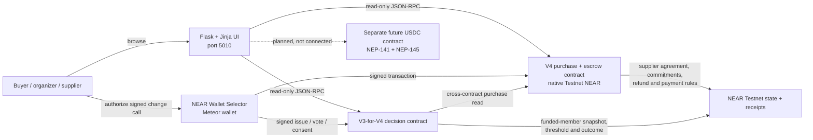

# Engineering decisions: making a group buy enforceable

> **Submission-safe summary:** HarvestPool V4 is a working NEAR Testnet prototype for
> supplier-authorized group purchases settled in native Testnet NEAR. Its separate V3 contract
> supports funded-member decisions but has a disclosed storage-availability defect. An isolated V5
> native-USDC candidate and corrected V3-for-V5 are implemented and Sandbox-tested locally; neither
> is deployed or demonstrated with Circle's official token on Testnet.

HarvestPool started with a practical question: how can several households place one order without
turning an organizer into an informal bank? That led to a contract-enforced lifecycle rather than a
marketplace database with blockchain branding. This document ties each design choice to source,
Sandbox coverage, or time-stamped Testnet evidence. A passing unit test proves only the tested
invariant; it is not proof of a complete browser or production journey.

## Evidence levels used here

| Label | Meaning |
| --- | --- |
| **Implemented** | Present in the current local source. |
| **Sandbox verified** | Exercised through local NEAR accounts and receipts with `near-workspaces`. |
| **Testnet observed** | Read from, or linked to, a deployed Testnet contract/transaction. |
| **Planned** | Architecture only; not a working HarvestPool feature. |

The full command log, findings, and native-USDC feasibility work are in the
[infrastructure reliability audit](infrastructure-reliability-audit.md).

## A. Protecting pooled contributions

**Problem:** In an informal group buy, the organizer can receive every member's money, change the
recipient, or disappear before ordering.

**Why it matters:** Better bulk pricing is not useful if members must accept a single person's
custody and bookkeeping. Suppliers also need an objective indication that the order is actually
funded.

**Our approach:** V4 records a commitment only when the caller attaches exactly
`price_per_unit × quantity`. The contract, not Flask or the organizer, holds native Testnet NEAR.
It exposes no organizer withdrawal, arbitrary-recipient transfer, or generic sweep method. The
only supplier transfer follows evidence and the required funded-member approval; refunds go back to
the contributing account. Purchase terms and the supplier recipient have no update method after the
agreement opens.

**Why NEAR:** The predecessor account authenticates the wallet that signed each change call. An
attached deposit and state update execute atomically in the contribution receipt. Contract state is
publicly readable, while outgoing transfers use promises and private callbacks instead of trusting
the Flask server to report success.

**Evidence:**

- **Implemented:** exact amount, duplicate-account, deadline, supplier, household, and unit-capacity
  checks in [`commit`](../contract-v4/src/lib.rs#L444); payment and refund entry points in
  [`release_payment`](../contract-v4/src/lib.rs#L640) and
  [`claim_refund`](../contract-v4/src/lib.rs#L660).
- **Sandbox verified:** V4 journeys covered exact contributions, failure/refunds,
  fulfillment/payment, a failed transfer callback, and two concurrent attempts for the last spot.
  Exactly one final-slot attempt succeeded. No unauthorized release, duplicate refund, or duplicate
  payout was reproduced.
- **Testnet observed:** V4 reports `payment_asset: native-testnet-near`; the 2026-11-09 read found
  purchase `0` open with one active native-NEAR commitment. Deployment and receipt links are in
  [the V4 record](v4-deployment.md).

**Limitations:** This is Testnet, not an audited production custody system. Deployment keys can
replace contract code. Contributions share the contract account with its NEAR storage reserve, so
liquid headroom must be monitored. A callback that never executes can leave a transfer pending and
cannot safely be retried without reconciliation. Native NEAR also exposes dollar-priced purchases
to volatility.

## B. Supplier-authorized agreements

**Problem:** An organizer can publish a supplier's name, price, delivery promise, or refund policy
without the supplier ever accepting those terms.

**Why it matters:** A group may fund a deal the supplier did not make. That creates disputes even
if the pooled money itself is held correctly.

**Our approach:** V4 has two creation paths. An allowlisted supplier can sign
`create_supplier_offer`, which opens immediately. An organizer's `create_purchase_request` remains
`AwaitingSupplier` until the named supplier signs acceptance; only that supplier can accept or
decline. Acceptance records a SHA-256 agreement fingerprint bound to the purchase ID, participants,
supplier profile, and complete serialized financial and fulfillment terms. There is no method to
edit those protected terms after acceptance.

**Why NEAR:** Wallet signatures bind a contract call to a NEAR account. The state transition,
agreement fingerprint, block position, and immutable terms can be read independently of the web
server.

**Evidence:**

- **Implemented:** supplier offer/request/accept/decline paths in
  [`contract-v4/src/lib.rs`](../contract-v4/src/lib.rs#L366) and the fingerprint regression test in
  the same file.
- **Sandbox verified:** unauthorized creation and supplier response were rejected; the authorized
  flow opened with the expected supplier and terms.
- **Testnet observed:** V4 is initialized with one controlled pilot supplier and reports lifecycle
  `supplier-authorized-no-offer-vote`. Initialization transaction and bytecode hashes are in
  [the V4 deployment handoff](v4-deployment.md).

**Limitations:** An allowlisted wallet proves control of that Testnet account, not verified
real-world business identity, authority to represent a business, delivery quality, or legal
enforceability. The pilot supplier profile explicitly says unavailable location/contact data is
“Not provided.” Key rotation and supplier suspension are not implemented.

## C. Fair group decisions

**Problem:** Our earlier lifecycle asked a fixed community to approve an offer before anyone had
contributed. That let non-buyers influence whether buyers could transact and did not solve later
coordination questions among the people actually at risk.

**Why it matters:** Eligibility should come from a funded stake in the specific purchase, not from
opening a link, joining a general community, or buying more units. The group also needs a defined
outcome when opinions split.

**Our approach:** V4 removes the old offer-approval vote: supplier authorization opens the deal.
One successful active commitment creates one funded membership regardless of quantity. V4 uses
those funded members for fulfillment approval. The separate V3-for-V4 contract rereads V4,
snapshots active funded accounts when a decision opens, and gives each account one public vote.
Yes/No and multiple-choice ballots pass only when one option reaches `ceil(2n/3)`. A Yes/No
threshold for “No” produces rejection. If all voters participate and no option reaches the
threshold, the result is `NoConsensus`; an unfinished ballot can expire after its deadline.
Supplier-facing pickup arrangements still require the named supplier's agreement after the group
passes them.

V3 has no method that can alter price, quantity, supplier, commitments, V4 lifecycle state,
refunds, or payouts. A vote therefore cannot silently rewrite the protected financial agreement.

**Why NEAR:** V3 performs a cross-contract view of the configured purchase contract before writing
membership-sensitive state. Voter eligibility and public outcomes are independently readable, and
the financial contract remains a separate authority boundary.

**Evidence:**

- **Implemented:** voter snapshot and threshold construction in
  [`resolve_group_vote_request`](../contract-v3/src/lib.rs#L583), voting in
  [`vote_on_decision`](../contract-v3/src/lib.rs#L404), and threshold evaluation near
  [`evaluate_ballot`](../contract-v3/src/lib.rs#L977).
- **Sandbox verified:** V4/V3 compatibility tests covered funded-member authorization, frozen
  snapshots, outsider and duplicate rejection, Yes/No approval and rejection, a three-option
  winner, a three-way `NoConsensus` result, expiry, post-vote supplier consent, and unchanged V4
  financial fields.
- **Testnet observed:** the dedicated V3 account is configured to exactly
  `harvestpool-v4-dalamaa-20261109.testnet`; at the audit observation it held zero issues and zero
  decisions. No completed Testnet vote is claimed.

**Limitations:** Votes are public and one wallet is not proof of one human or household. V3 has a
confirmed pending-request storage leak described below. Group decisions are coordination metadata;
they do not adjudicate legal disputes or override the V4 agreement.

## D. Reliable contributions and refunds

**Problem:** Two members can try to claim the last place, a wallet can resubmit a transaction, a
transfer can fail, or a member can request the same refund twice.

**Why it matters:** Incorrect capacity or callback accounting creates real winners and losers. A UI
button being clicked is not a financial outcome.

**Our approach:** Each contribution is validated during contract execution against both total
quantity and the funded-household limit. NEAR serializes receipts, so concurrent last-place calls
do not reserve capacity off-chain: the first valid state change wins and the later call fails
without recording a commitment. Account uniqueness prevents a second commitment. Arithmetic is
checked and the release profile enables overflow checks.

Before an outgoing native transfer, the contract moves a refund to `RefundPending` or a purchase to
`PaymentPending`. That blocks duplicate calls. Its private callback checks the expected account,
amount, and state, then marks success once or restores the retryable state after an observed
failure. Refund eligibility comes from a timely voluntary cancellation or a failed purchase.
Supplier payment requires fulfillment evidence and the funded-member threshold.

**Why NEAR:** Receipt serialization makes the contract state—not browser timing—the capacity
authority. Promise results let the contract distinguish an observed transfer success from an
observed failure, while predecessor checks keep callbacks private.

**Evidence:**

- **Implemented:** checked commitment accounting and capacity checks in
  [`contract-v4/src/lib.rs`](../contract-v4/src/lib.rs#L444); terminal failure/refund transitions and
  callbacks in [`contract-v4/src/lib.rs`](../contract-v4/src/lib.rs#L640).
- **Sandbox verified:** simultaneous final-slot attempts accepted exactly one; wrong/duplicate
  operations were rejected; refund and payout failure callbacks restored retryable states; normal
  paths transferred the recorded amount. Browser-aligned calls use 30 Tgas with 20 Tgas reserved
  for callbacks.
- **Testnet observed:** Testnet transaction evidence exists for earlier Phase 1/V2 exact funding
  and a completed Phase 1 lifecycle in [testnet evidence](testnet-evidence.md). Those receipts are
  historical evidence, not proof that every V4 browser path has completed on Testnet.

**Limitations:** A failed transaction still costs gas. RPC timeout or wallet redirect uncertainty
must be reconciled by final outcome plus an authoritative state reread; local pending-action state
is only a resubmission guard. The current V4 deployment lacks an on-chain liabilities/reserve view.
An ambiguous missing callback cannot be automatically recovered safely.

## E. Asynchronous blockchain failures

**Problem:** Cross-contract calls and transfers complete across multiple receipts. Validation or a
callback may fail after the initiating transaction has returned control to the application.

**Why it matters:** Treating “submitted” as “paid,” or retrying an ambiguous payment, can create
false confirmations or duplicate transfers. Rejected requests can also consume storage.

**Our approach:** The browser saves wallet-scoped pending actions and polls/rereads authoritative
contract state before presenting completion. V4 writes pending financial state before a promise
and finalizes only in a private callback. The separate V3 validates membership through callbacks
rather than trusting browser-supplied identities.

**Evidence:** Two different findings must not be blurred:

1. **Confirmed V3 defect, unresolved in the deployed version.** V3 removes a pending request and
   then calls `require!` for expected rejection cases. A callback panic rolls back the removal, so
   invalid/duplicate requests retain storage. The added Sandbox characterization test reproduced
   **348 retained bytes** for one rejected duplicate request. This can deny the optional decision
   service but cannot transfer V4 funds. A new V3 must return cleanly after taking a request and add
   bounded/expiring pending entries. No such fix has been deployed.
2. **Confirmed V4 design gap with a hypothetical trigger.** When a callback executes and reports
   transfer failure, V4 restores a retryable state; Sandbox verified that. If the callback itself
   never executes, `RefundPending` or `PaymentPending` can remain indefinitely. No missing callback
   was observed. There is no safe automatic reset because the transfer could have succeeded. A
   future version needs operation IDs and a reviewed receipt/balance reconciliation process.

**Why NEAR:** NEAR exposes asynchronous promises and callback results, enabling explicit state
machines instead of pretending a distributed transfer is synchronous. It does not make ambiguous
outcomes disappear; the application must model them.

**Limitations:** V3 storage cleanup and V4 ambiguous-callback recovery are not completed fixes.
During the hackathon demo, use the proven V4 path, monitor receipts, and stop rather than resubmit
when final outcome is unknown.

## F. NEAR price volatility and the intended USDC version

**Problem:** Native NEAR is not a dollar-stable contribution asset. If a community contributes
tokens worth $100,000 and NEAR loses 30% of its dollar value before fulfillment, those tokens may
then be worth only $70,000.

**Why it matters:** Contract escrow can stop unauthorized withdrawal, but it cannot guarantee the
market value of the escrowed asset. A supplier pricing goods in dollars can still face a shortfall.

**Our approach:** Keep V4 unchanged as the native-Testnet-NEAR fallback. The separately versioned
V5 contract accepts only its configured Circle native-USDC account on NEAR Testnet via
NEP-141. USDC uses six decimals, so one USDC is raw integer `1_000_000`; no floating-point math or
24-decimal NEAR conversion belongs in token accounting.

The proposed inbound path is:

1. Member calls the configured token's `ft_transfer_call` with a versioned, bounded commit message.
2. `ft_on_transfer` verifies that `env::predecessor_account_id()` is exactly the immutable official
   token account; the message cannot choose the token.
3. The receiver checks exact raw amount, supplier agreement, deadline, duplicate membership, unit
   capacity, and household capacity in one execution.
4. A malformed, wrong-token, wrong-amount, expired, duplicate, or capacity-losing transfer writes
   no commitment and returns the full amount as unused. No partial household contribution is
   accepted.
5. A valid transfer atomically records the commitment and returns zero unused. The token's
   `ft_resolve_transfer` resolves unused tokens; a pending receipt is never called confirmed.

Refunds and supplier payouts require persistent operation IDs and explicit
`Refundable → RefundPending → Refunded` / `FulfillmentApproved → PaymentPending → Completed`
states around `ft_transfer`. The private callback must match token, operation, recipient, amount,
and expected state. Observed failure restores retryability; an absent callback remains frozen for
manual, evidence-based reconciliation.

**Why NEAR:** NEP-141 provides the token transfer/receiver/resolver interface, and NEP-145 defines
storage registration. Cross-contract promises permit explicit callbacks. V3 compatibility can be
preserved through the same `get_purchase`, `get_funded_members`, and `is_funded_member` views while
giving V3 no token authority.

**Evidence:** V5, V3-for-V5, and a standards-based mock token are implemented locally. Four Sandbox
journeys passed using real cross-contract receipts and injected outbound transfer failures. A
read-only final RPC call reported Circle's token as `USDC`, six decimals, `ft-1.0.0`. The current V4
account remains native NEAR. See [V5 readiness](v5-usdc.md) for identity and artifact evidence.

**Limitations:** Deployment, V5 token storage registration, and genuine official-token transactions
do not exist yet. Circle's public faucet now lists Near Testnet and advertises 20 USDC per request,
but no claim was made during this review. USDC availability, pause/blocklist policy, issuer risk,
redemption, recipient registration, and the contract's separate NEAR gas/storage reserve remain
external risks. A stable token reduces price volatility; it does not guarantee fulfillment,
liquidity, redemption, or recovery.

## G. Keeping blockchain complexity away from customers

**Problem:** Customers want to understand the product, supplier, amount, deadline, delivery, vote,
and refund—not receipt graphs or yoctoNEAR internals.

**Why it matters:** Technical transparency is useful only when it supports informed action. Making
chain terminology the primary interface increases signing mistakes and obscures the agreement.

**Our approach:** The Flask/Jinja interface uses “Group Deals,” “Deal Terms,” “Join This Deal,”
“My Group Buys,” “My Decisions,” “Claim refund,” and “Supplier dashboard.” Public browsing needs no
wallet. The wallet is introduced only when identity or a signature is required. Exact Testnet NEAR,
contract account, agreement fingerprint, transaction status, and verification details remain
available near the relevant action. The UI rereads contract state after signing instead of treating
a popup close or button click as success.

**Why NEAR:** Wallet authorization keeps private keys outside HarvestPool. Read-only RPC lets the
marketplace render public state without a user account, while signed change calls preserve the
contract as the authority.

**Evidence:**

- **Implemented:** Flask routes for Explore, details, agreement/contribution, supplier invitation,
  issue creation, My Group Buys, My Decisions, setup guide, and supplier dashboard in
  [`web/app.py`](../web/app.py); wallet/RPC and pending-action reconciliation in
  [`web/static/app.js`](../web/static/app.js).
- **Locally verified:** 23 JavaScript tests passed, JavaScript syntax and Python compilation passed,
  and all 11 customer routes returned HTTP 200 on port 5010.

**Limitations:** Wallet popup/redirect behavior, accessibility, and responsive layouts still need a
recorded manual pass in the final public build. RPC, wallet, CDN, and CoinGecko availability can
degrade the interface. Friendly words do not remove the need to inspect the wallet prompt.

## Current architecture

### Authority boundaries

| Component | What it does | What it cannot do |
| --- | --- | --- |
| Flask/Jinja + SQLite | Pages, public configuration, nonfinancial metadata, transaction preparation | Sign for a user, hold pooled funds, determine eligibility, release payment |
| NEAR wallet | Shows the signer and authorizes each change call | Change contract rules |
| V4 purchase contract | Supplier agreement, exact commitments, funded membership, lifecycle, refunds, supplier payout | Verify real-world identity/delivery; stabilize NEAR's market price |
| V3-for-V4 | Issues, voter snapshots, threshold outcomes, supplier consent for permitted decisions | Change V4 financial terms or move funds |
| Testnet RPC / Explorer | Public state and receipt evidence | Guarantee the customer has interpreted the agreement correctly |

### Actual NEAR stack

- Rust contracts using `near-sdk` 5.30.1, Borsh state serialization, attached deposits,
  predecessor identity, promises, promise-result callbacks, block timestamps, and SHA-256.
- `near-workspaces` 0.24.0-rc.2 and local `near-sandbox` for multi-account integration journeys.
- `cargo-near`/`cargo near build` for optimized WASM artifacts; current deployed artifacts are
  standard host builds, with their reproducibility limitation disclosed in
  [the deployment record](v4-deployment.md).
- Browser read-only JSON-RPC plus NEAR Wallet Selector 10.1.4 and the Meteor Wallet connector for
  user-signed Testnet calls.
- NEP-141 and NEP-145 appear only in the future USDC design. They are not integrated into V4.

## Evolution in one view

| Version | Decision made | What we learned |
| --- | --- | --- |
| V2 purchase lifecycle | Fixed-community offer vote before funding; later exact native-NEAR commitments | Pre-funding voters were not necessarily the buyers at risk. |
| V3 decision companion | Snapshot active funded members for bounded Yes/No or multiple-choice decisions | Financial isolation works, but callback rejection cleanup needs a new version. |
| V4 purchase lifecycle | Supplier signature replaces the pre-contribution offer vote; funded members approve fulfillment | Supplier authorization and buyer eligibility solve different trust problems and should not be conflated. |
| Future USDC version | Separate NEP-141 receiver/transfer architecture, preserving V4 | Escrow authorization does not solve native-asset price volatility. |

HarvestPool's innovation is this progression: each trust problem is assigned to the smallest
on-chain authority that can enforce it, while the customer-facing application remains a readable
marketplace rather than a custody service.
